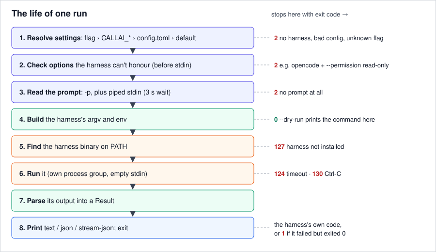

# Architecture

callai is a thin translator. One adapter per harness builds the command line and reads the output back,
and a single runner runs everything, for both the CLI and the Python API.

The same flow in words:

1. **Entry:** the CLI resolves flags, `CALLAI_*` variables and `config.toml`. The Python API takes
   keyword arguments only. Both produce a `Request`, one per harness when fanning out.
2. **Build:** the harness's adapter turns the request into a command line (`build_argv`) and any
   environment variables (`build_env`). It does no I/O, which is why `--dry-run` can print the command
   without the harness installed.
3. **Run:** `runner.run` finds the binary on `PATH` and starts it in its own process group, with an
   empty stdin. It reads stdout line by line as it arrives. On timeout it kills the whole group (exit
   124); on Ctrl-C it sends SIGINT to the group (exit 130).
4. **Read:** the same adapter turns each stdout line into stream events (`stream_events`) and the
   finished output into a `Result` (`parse`).
5. **Out:** the CLI prints text, JSON or stream events; the API returns the `Result`. `-o raw` skips
   step 4 and prints the harness's own output.

## The run, step by step

| Step | Can stop with |
|---|---|
| 1. Resolve settings (flag › env › config › default) | exit 2: no harness, bad config, unknown flag |
| 2. Check the options the harness can't honour, **before reading stdin** | exit 2 |
| 3. Read the prompt (`-p`, plus piped stdin; 3 s wait on an idle pipe) | exit 2: no prompt |
| 4. Build argv and env | `--dry-run` prints here, exit 0 |
| 5. Find the binary | exit 127 |
| 6. Run | exit 124 (timeout), 130 (Ctrl-C) |
| 7. Parse | — |
| 8. Print | the harness's exit code, or 1 if it failed but exited 0 |

Step 2 comes before step 3 so that an impossible request fails at once, instead of after waiting for
a slow pipe.

## Why it's built this way

- **One adapter file per harness, pure functions.** Adapters are tested without any harness installed.
  A shared, language-agnostic [conformance suite](../../../conformance/README.md) pins their behaviour,
  and later ports (TypeScript, Rust) will run the same suite.
- **Always ask for structured output.** callai runs `claude --output-format json` even for `-o text`.
  The answer is taken from structured data, never scraped from a terminal display. hermes has no JSON
  mode, so its adapter strips the display lines instead.
- **The prompt is always last** (after `--`, or as one `--opt=PROMPT` argument), so a prompt can't be
  read as a flag.
- **Empty stdin for the harness.** Some harnesses read stdin when it isn't a terminal. callai reads
  stdin itself (into the prompt), so the harness gets an empty one.
- **No runtime dependencies.** Standard library only: fast start-up and easy installation.

## Code map

| Module | Role |
|---|---|
| `callai/cli.py` | Flags, defaults, rendering, exit codes |
| `callai/api.py` | `run()`, and `run_harness()`, the one run path |
| `callai/fanout.py` | `-n a/b`, `-n a,b`, `-n all` |
| `callai/runner.py` | Subprocess, process groups, timeouts, live output |
| `callai/config.py` | `config.toml`, aliases |
| `callai/request.py`, `result.py`, `errors.py` | The data types |
| `callai/adapters/*.py` | One per harness, plus `base.py` |

See also: [Add a new harness](../guides/add-a-harness.md) · [Harnesses reference](../reference/harnesses.md) · [Design notes](../../DESIGN.md)
