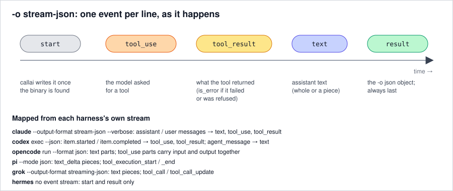

# Normalised output

Every harness reports its answer, errors, session and token use differently. callai maps them all onto
one result and one event stream, so code that reads callai's output works with any harness.

## One result

| Harness | Native output | Where the answer is | Error signal |
|---|---|---|---|
| claude-code | one JSON object | `result` | `is_error`, which can be true while `subtype` says `"success"` |
| codex | JSON lines | the last `agent_message` item | a `turn.failed` event |
| opencode | JSON lines | the text of the last step (earlier steps come before tool calls) | an `error` event or a non-zero exit; the reason is taken from stderr's ERROR log line |
| pi | JSON lines | the last assistant message | `stopReason` of `error`, `aborted` or `length` (pi exits 0 even then) |
| grok | one JSON object | `text` | `{"type": "error"}`, or `stopReason` other than `end_turn` |
| hermes | plain text | stdout minus its display lines (those end in `\r\n`) | a non-zero exit, or no answer |

callai's result has the same keys whichever harness answered. A value the harness doesn't report is
`null` rather than left out. See the [output reference](../reference/output.md#-o-json) for every field.

## Rules that make results comparable

- **`is_error` comes from the harness's explicit error signal**, never from a status word that can
  disagree with it.
- **`usage.input_tokens` counts every prompt token, cache reads and writes included.** codex already
  counts them that way. For claude, opencode, pi and grok, callai adds the cache counts back in, so the
  numbers compare across harnesses.
- **`model` is the model the harness says it used** (claude, pi, grok report it), otherwise the one
  you asked for.
- **`exit_code` is the harness's own.** callai's process exits with it, or with 1 when the harness
  reported an error but exited 0.

## One event stream

`-o stream-json` maps each harness's native stream onto five event types:

| callai event | claude | codex | opencode | pi | grok |
|---|---|---|---|---|---|
| `text` | assistant `text` block | `agent_message` item | `text` part | `text_delta` | `text` |
| `tool_use` | assistant `tool_use` block | `item.started` | `tool_use` part | `tool_execution_start` | `tool_call` |
| `tool_result` | user `tool_result` block | `item.completed` | the same `tool_use` part, once finished | `tool_execution_end` | `tool_call_update` (completed or failed) |

hermes has no event stream, so it gives only `start` and `result`. callai writes `start` and `result`
itself; the adapters produce the rest.

## What isn't normalised

- **Tool names and inputs** are the harness's own (`Bash` and `{"command": …}` for claude,
  `command_execution` for codex). Mapping them onto a common set would hide real differences.
- **The text granularity** of events: whole messages for some harnesses, pieces for others.
- **`-o raw`**, which is the harness's output, byte for byte.

See also: [Output formats reference](../reference/output.md) · [Architecture](architecture.md)
