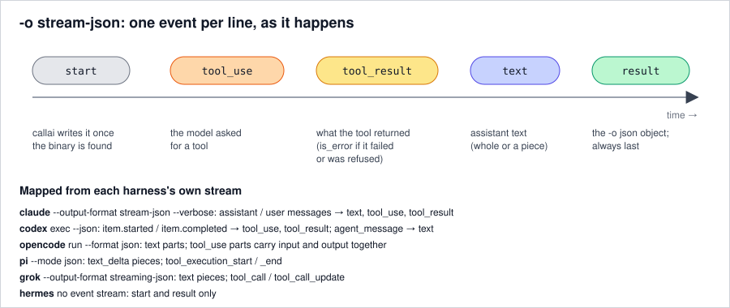

# 4. Watch a run as it happens

`-o stream-json` prints one JSON event per line while the harness works: what it says, which tools it
calls, and what they return, followed by the result.

**You'll need:** [step 2](02-json-output.md).

## Stream a run

```bash
callai -n pi -m stub/stub-model -p "Reply with exactly: pong" -o stream-json
```

```json
{"type": "start", "harness_name": "pi", "model": "stub/stub-model", "argv": ["pi", "--mode", "json", "--model", "stub/stub-model", "--", "Reply with exactly: pong"]}
{"type": "text", "text": "pong"}
{"type": "result", "harness_name": "pi", "model": "stub/stub-model", "text": "pong", "exit_code": 0, "is_error": false, "duration_ms": 1047, "session_id": "01a19507-07fe-7550-b76e-7a5f6b29a908", "usage": {"input_tokens": 11, "output_tokens": 2}, "cost_usd": 0, "argv": ["pi", "--mode", "json", "--model", "stub/stub-model", "--", "Reply with exactly: pong"]}
```

Each line is written and flushed as soon as it happens, so a reader sees progress live.



There are five event types:

| `type` | When | Fields |
|---|---|---|
| `start` | Once, when the harness binary has been found | `harness_name`, `model`, `argv` |
| `text` | The assistant wrote text | `text` |
| `tool_use` | The model called a tool | `id`, `name`, `input` |
| `tool_result` | The tool returned | `id`, `is_error`, `output` |
| `result` | Always last | The same fields as `-o json` |

## A run with a tool call

When the agent uses a tool, you see the call, then its result, then the answer. This is claude
running a shell command:

```json
{"type": "start", "harness_name": "claude-code", "model": null, "argv": ["claude", "-p", "--output-format", "stream-json", "--verbose", "--", "Say hi."]}
{"type": "tool_use", "id": "toolu_stub_1", "name": "Bash", "input": {"command": "echo hi"}}
{"type": "tool_result", "id": "toolu_stub_1", "is_error": false, "output": "hi"}
{"type": "text", "text": "pong"}
{"type": "result", "harness_name": "claude-code", "text": "pong", "is_error": false, "…": "…"}
```

`name` and `input` are the harness's own tool name and arguments: `Bash` for claude,
`command_execution` for codex, `bash` for pi and opencode, `run_terminal_command` for grok.
`tool_result.id` matches the `tool_use` it answers. A refused or failed call has `"is_error": true`.

## What differs between harnesses

- `text` is a whole message for claude, codex and opencode, but pieces of a message for pi and grok.
  Join the `text` events in order to get everything the assistant said. The final answer is always
  `result.text`.
- callai switches claude to `--output-format stream-json --verbose` and grok to
  `--output-format streaming-json`. The other harnesses already stream.
- hermes has no event stream, so you get only `start` and `result`.

## When something goes wrong

- If the harness isn't installed, nothing is printed on stdout (not even `start`), and callai exits
  127.
- A failed run still ends with a `result` event with `is_error: true`.
- A timeout (124) or Ctrl-C (130) ends the stream without a `result`. The exit code says why.

## Recap

- `-o stream-json` = `start`, then `text` / `tool_use` / `tool_result` live, then `result`.
- Same events for every harness; `result` is the `-o json` object.
- No `result` line means callai itself stopped the run: check the exit code.

Reference: [Stream events](../reference/output.md#-o-stream-json) · Guide: [Build a live progress view](../guides/live-progress.md)

Next: [5. Continue a conversation](05-sessions.md) · Previous: [3. Control what the agent may do](03-permissions.md)
