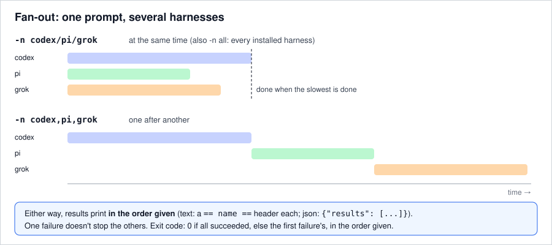

# 6. Ask several harnesses at once

Give `-n` several names to run one prompt through each of them. Separate the names with `/` to run
them at the same time, or with `,` to run them one after another. `-n all` runs every installed harness.

**You'll need:** [step 2](02-json-output.md), and two or more harnesses installed.

## At the same time

```bash
callai -n codex/pi/grok -p "Reply with exactly: pong"
```

```text
== codex ==
pong
== pi ==
pong
== grok ==
pong
```

The answers print in the order you named the harnesses, whichever finishes first, each under a
`== name ==` header.



## One after another

```bash
callai -n codex,pi,grok -p "Reply with exactly: pong"
```

The output looks the same. The difference is timing, and what the harnesses can see: they all share
one working directory, so use `,` for prompts that edit files. Otherwise two agents edit the same files
at once.

## Every installed harness

```bash
callai -n all -p "Reply with exactly: pong" --permission read-only
```

```text
callai: skipping opencode: --permission read-only: opencode has no read-only mode (its plan agent still allows shell commands); pass `-- --agent plan` yourself if that is acceptable
callai: skipping hermes: --permission read-only: hermes has no read-only toolset (its `file` toolset can write); use the default or --permission auto
== claude-code ==
pong
== codex ==
pong
== pi ==
pong
== grok ==
pong
```

`-n all` uses only the harnesses that are installed, and skips (with a note on stderr) any that can't
honour your options. With an explicit list, a harness that can't honour them stops the whole call
before anything runs.

## When one fails

```bash
callai -n claude-code/codex -m not-a-real-model-xyz -p hi
echo "exit=$?"
```

```text
== claude-code (failed, exit 1) ==
There's an issue with the selected model (not-a-real-model-xyz). It may not exist or you may not have access to it. Run --model to pick a different model.
== codex (failed, exit 1) ==
The model `not-a-real-model-xyz` does not exist.
exit=1
```

One failure doesn't stop the others. Each failed harness's own stderr follows on stderr under a
`--- name stderr ---` line. The exit code is 0 if every run succeeded, otherwise the first failure's in
the order given. A harness that times out becomes a failed result with exit code 124, and the others
keep going. Ctrl-C stops them all (exit 130).

## JSON and events

- `-o json` gives `{"results": [ … ]}`: one `-o json` object per harness, in order.
- `-o stream-json` interleaves the harnesses' events live. Every event carries `harness_name`.
- `--dry-run` prints one command line per harness. With `-o json` it prints `{"runs": [ … ]}`.

## Rules

- `-m` applies to every harness. Model names differ between harnesses, so give each its own with a
  [model alias](07-defaults.md#name-models-once-with-aliases), or leave `-m` out.
- Piped stdin is read once and shared.
- `-o raw` and arguments after `--` need a single harness, because they are specific to one harness.
- Mixing separators (`a/b,c`), repeating a name, or putting `all` in a list is a usage error.

## Recap

- `-n a/b/c` runs at the same time, `-n a,b,c` one after another, and `-n all` every installed harness.
- Results come back in the order given; the exit code is the first failure's.

Reference: [`-n`](../reference/cli.md#-n-harness_name---name-harness_name) · [Fan-out output](../reference/output.md#fan-out) · Guide: [Compare harnesses side by side](../guides/compare-harnesses.md)

Next: [7. Set your defaults](07-defaults.md) · Previous: [5. Continue a conversation](05-sessions.md)
