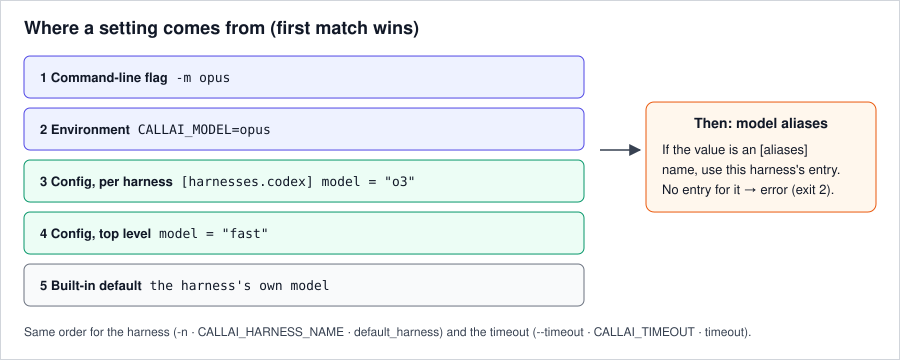

# 7. Set your defaults

Set a default harness, model and timeout once, in environment variables or a config file, and give
models short names that mean the right thing for each harness.

**You'll need:** [step 1](01-first-prompt.md).

## Environment variables

```bash
export CALLAI_HARNESS_NAME=codex
export CALLAI_TIMEOUT=600
callai -p "Reply with exactly: pong"          # runs codex, killed after 10 minutes
```

| Variable | Sets | Same as |
|---|---|---|
| `CALLAI_HARNESS_NAME` | Harness (also `a/b`, `a,b`, `all`) | `-n` |
| `CALLAI_MODEL` | Model or alias | `-m` |
| `CALLAI_TIMEOUT` | Seconds | `--timeout` |
| `CALLAI_STDIN_WAIT` | Seconds to wait for piped input with `-p` (default 3) | — |
| `CALLAI_CONFIG` | Path of the config file | — |

A flag always wins over its variable. An empty variable counts as unset.

## The config file

callai reads `~/.config/callai/config.toml` (or `$XDG_CONFIG_HOME/callai/config.toml`, or the file
named in `CALLAI_CONFIG`). It is optional:

```toml
default_harness = "claude-code"
model = "fast"                       # default model for every harness (here an alias)
timeout = 600

[harnesses.codex]
model = "gpt-5-codex"                # codex's own default; beats the top-level model
extra_args = ["--ephemeral"]         # passed to codex before anything after --

[aliases]
fast  = { claude-code = "haiku", codex = "gpt-5-codex-mini", opencode = "anthropic/claude-haiku-4-5" }
smart = { claude-code = "opus",  codex = "gpt-5-codex" }
```

With that file:

```bash
callai -p "Explain main.py" --dry-run
callai -n codex -p "Explain main.py" --dry-run
callai -n codex -m smart -p "Explain main.py" --dry-run
CALLAI_MODEL=o3 callai -n codex -p "Explain main.py" --dry-run
```

```text
claude -p --output-format json --model haiku -- 'Explain main.py'
codex exec --json --skip-git-repo-check --model gpt-5-codex --ephemeral -- 'Explain main.py'
codex exec --json --skip-git-repo-check --model gpt-5-codex --ephemeral -- 'Explain main.py'
codex exec --json --skip-git-repo-check --model o3 --ephemeral -- 'Explain main.py'
```

Line by line:
1. No `-n`, so `default_harness` chose claude-code. The top-level `model = "fast"` resolved through
   the alias to `haiku`.
2. codex's own `[harnesses.codex] model` beat the top-level one, and its `extra_args` were added.
3. `-m smart` resolved to codex's entry in the `smart` alias, which is also `gpt-5-codex`.
4. `CALLAI_MODEL` beat the config, and `o3` isn't an alias, so it passed through unchanged.

## Precedence



The first source that sets a value wins:

1. command-line flag;
2. `CALLAI_*` environment variable;
3. `[harnesses.<name>]` in the config file (`model` only);
4. top level of the config file;
5. the harness's own default.

Model aliases are resolved after that.

## Name models once with aliases

An alias maps one name to a model per harness. `-m fast` means `haiku` for claude-code and
`gpt-5-codex-mini` for codex. That is what makes `-m` useful with [fan-out](06-fan-out.md). A model that
isn't an alias goes to the harness unchanged. An alias with no entry for the harness you're running is
an error, so a wrong model is never sent:

```text
callai: error: model alias 'smart' has no entry for pi
```

## Typos are errors

Unknown keys, unknown harness names and wrong types stop callai with exit 2, naming the file:

```text
callai: error: /home/me/.config/callai/config.toml: unknown key 'defualt_harness'; allowed: aliases, default_harness, harnesses, model, timeout
```

## Recap

- Defaults come from flag › environment › config file › harness default.
- `[harnesses.<name>]` sets a per-harness `binary`, `model` and `extra_args`.
- `[aliases]` give one model name a meaning per harness.

Reference: [Configuration](../reference/configuration.md)

Next: [8. Use callai from Python](08-python-api.md) · Previous: [6. Ask several harnesses at once](06-fan-out.md)
